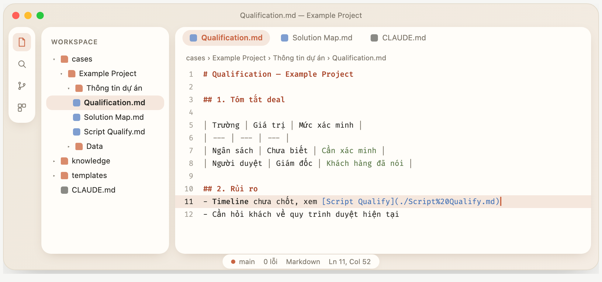

# Giao diện VS Code "thẻ nổi + đất nung"

Giao diện sáng, bo góc, tối giản (kiểu Claude Desktop / Codex): Explorer, activity bar và editor là các thẻ nổi bo 16px trên nền kem; hai viên thuốc ở đáy (thanh tìm và status bar); tab dạng viên thuốc; icon tệp là ô vuông bo tròn có ký hiệu riêng cho từng loại.



*Ảnh là bản mẫu mô phỏng bằng HTML (`demo-mockup.html`), bản thật trong VS Code gần giống chứ không khớp từng pixel.*

Viết và kiểm tra trên **VS Code 1.142.0**. Phần CSS bám vào cấu trúc nội bộ của VS Code nên một bản cập nhật lớn có thể làm lệch vài chỗ.

## Trong gói này

| File | Làm gì |
|---|---|
| `float-clay.css` | Toàn bộ phần bo góc, khe, bóng, viên thuốc, icon tệp, command palette |
| `float-clay-menu.js` | Đoạn JS nhỏ chỉ để chèn CSS vào menu chuột phải / dropdown (xem mục "Điều cần biết") |
| `settings-float-clay.json` | Các setting đi kèm (theme, bảng màu, font, bật chế độ thẻ nổi...) |
| `install.sh` | Cài tự động trên macOS / Linux |
| `demo-mockup.html` | Bản mẫu thiết kế ban đầu, mở bằng trình duyệt để so sánh |
| `images/demo.png` | Ảnh minh hoạ dùng trong README |

## Lấy từ GitHub

```bash
git clone https://github.com/duongidle/vscode_style.git
cd vscode_style
./install.sh
```

Sau đó làm tiếp các bước bên dưới (bật CSS trong VS Code).

## Cài trên máy mới (macOS / Linux)

1. Cài VS Code (bản 1.142 trở lên).
2. Mở Terminal trong thư mục này và chạy:
   ```bash
   ./install.sh
   ```
   Script chép CSS vào `~/.vscode-custom/`, gộp setting vào `settings.json` (sao lưu trước, hỏi xác nhận), và cài extension nếu tìm thấy lệnh `code`.
3. Mở VS Code, bấm `Cmd+Shift+P` (Windows/Linux: `Ctrl+Shift+P`), chạy **Enable Custom CSS and JS**, rồi bấm **Restart**.
4. Khi VS Code báo "installation appears to be corrupt", chọn **Don't show again**. Đó là hệ quả bình thường vì extension sửa một file của app.

Script không bao giờ tự sửa file của VS Code. Bước 3 phải làm tay.

## Cài thủ công (Windows, hoặc không muốn chạy script)

1. Cài extension **Custom CSS and JS Loader** (`be5invis.vscode-custom-css`).
2. Chép `float-clay.css` và `float-clay-menu.js` vào thư mục `.vscode-custom` trong thư mục cá nhân của bạn
   (macOS/Linux: `~/.vscode-custom/`, Windows: `C:\Users\<tên>\.vscode-custom\`).
3. Mở `settings.json` (`Cmd/Ctrl+Shift+P` → *Open User Settings (JSON)*), dán nội dung `settings-float-clay.json` vào, gộp với những khoá đã có. Đường dẫn trong `vscode_custom_css.imports` dùng `${userHome}` nên chạy được trên cả ba hệ điều hành.
4. Nếu đang có `"window.density.layout": "compact"` thì xoá nó, vì chế độ này làm khe giữa các thẻ bị nén.
5. Chạy **Enable Custom CSS and JS** và Restart như trên.

## Nếu bạn bật Settings Sync

`settings.json` và danh sách extension sẽ tự đồng bộ sang máy khác. **File CSS và phần "bật CSS" thì không đồng bộ**, nên trên máy khác chỉ cần: chép `float-clay.css` và `float-clay-menu.js` vào `~/.vscode-custom/`, rồi chạy **Enable Custom CSS and JS** (bước 3 ở trên).

## Sau khi VS Code cập nhật

Mỗi lần VS Code cập nhật, phần bật CSS bị mất. Chạy lại **Enable Custom CSS and JS** (hoặc **Reload Custom CSS and JS**) rồi Restart. Khi bạn sửa nội dung `float-clay.css`, cũng chạy **Reload Custom CSS and JS** rồi Restart, vì extension nhúng CSS vào lúc chạy lệnh.

Nếu sau cập nhật giao diện bị lệch (khe sai, viên thuốc lạc chỗ), mở `float-clay.css` và xem các khối có chú thích tiếng Việt, hoặc báo lại để chỉnh.

## Gỡ

1. Chạy **Disable Custom CSS and JS** và Restart.
2. Khôi phục `settings.json` từ bản sao lưu trong `~/.vscode-custom/backup/` (hoặc xoá các khoá có trong `settings-float-clay.json`).

## Điều cần biết

- **Toàn màn hình.** Khi toàn màn hình, các thẻ kéo lên sát mép trên. Khi cửa sổ thường, chừa 8px cho nút đèn giao thông của macOS.
- **Bản VS Code thấp hơn 1.142.** Chế độ thẻ nổi (`workbench.experimental.modernUI`) chưa có, giao diện sẽ không giống.
- **Quyền ghi.** Extension cần quyền ghi vào thư mục app VS Code. Trên macOS bản cài kiểu thông thường chạy được.
- **Menu chuột phải và dropdown.** Trên macOS, VS Code mặc định dùng menu gốc của hệ điều hành, CSS không đổi được. Gói này đặt `"window.menuStyle": "custom"` để VS Code tự vẽ các menu đó, nhờ vậy mới đổi được màu, bo góc và bóng. Đổi lại, menu không còn là menu gốc của macOS. Muốn trả về như cũ, xoá dòng `window.menuStyle` trong `settings.json` (menu của thanh menu trên cùng màn hình vẫn luôn là menu gốc).
- **Hai loại menu.** Menu chuột phải nằm trong shadow DOM (cần file JS bên dưới để chỉnh), còn dropdown trên thanh công cụ và đường dẫn (như "Xem trước hình ảnh") nằm ngoài shadow DOM nên `float-clay.css` chỉnh trực tiếp. Cả hai dùng cùng số đo.
- **Dòng menu cao hơn (cần file JS).** Menu nằm trong lớp "shadow DOM" mà CSS ngoài không chạm tới được, và chiều cao dòng (24px) bị cố định bên trong. Vì vậy gói có thêm `float-clay-menu.js` (khoảng 40 dòng), việc duy nhất nó làm là chèn một khối CSS vào lớp đó mỗi khi có menu bật lên (dòng cao 28px, góc bo 10px, đường kẻ ngăn thụt vào). Nó không đọc hay gửi dữ liệu nào ra ngoài; có thể mở file ra đọc. Nếu không muốn dùng JS, bỏ dòng `float-clay-menu.js` khỏi `vscode_custom_css.imports` là xong, menu vẫn đổi màu và bo góc như cũ, chỉ dòng không cao thêm.
- **Command palette.** Được bo tròn và đổi màu bằng CSS và các màu `quickInput*` trong setting. Mỗi dòng trong code VS Code bị cố định cao 22px nên gói phóng cả khung lên 1.3 lần bằng `transform` rồi thu chữ lại, để dòng cao 28.6px mà chữ vẫn 12.5px.
- **Panel của extension (Claude Code...).** Nội dung bên trong là webview, CSS này chỉ bo góc và chừa lề, không đổi giao diện bên trong.

## Chỉnh nhanh

| Muốn đổi | Sửa ở đâu |
|---|---|
| Màu nền bao quanh các thẻ | `settings.json` → `workbench.colorCustomizations` → `[Light Modern]` → `modernUI.shellBackground`, `titleBar.*`, `statusBar.background` (hiện `#f4f0e8`) |
| Màu nhấn đất nung | cùng khối trên, tìm `#c96442` |
| Khoảng thụt mỗi cấp thư mục | `workbench.tree.indent` (hiện 10) |
| Độ bo góc thẻ | `float-clay.css`, `--vscode-cornerRadius-large` và các `border-radius: 16px` |
| Màu từng loại icon tệp | `float-clay.css`, khối `--clay-ico-*` (đổi mã màu `%23xxxxxx`) |
